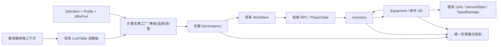

> 2026-11-04 栏位更新：Feet 停用，原鞋子位置改为 Amulet2；Legs 包含裤靴，仍为十个有效栏位。旧文中的 Feet 配置及独立腿鞋规划由 [双护符栏说明](AccessoriesAndConsumables.md) 覆盖。

# 随机装备与批量装备资产生产路线图

审计日期：2026-10-29。范围：当前工作区源码、配置、测试源码、文档和资源文件清单。**本次仅新增本文，不实施功能，不保存或重导入资产。**

后续执行更新（2026-10-30）：用户授权的M0–M3实现与单机自动验证已交付：UE5.8.2构建通过、相关自动化34/35通过、12件随机装备headless PIE拾取穿脱通过；1730旧固定断言差异、人工视听交互和双端网络仍待验收。详见 [Progress](Progress.md) 与 [实施契约](RandomEquipmentMVP.md)。下文审计和“本轮”验证描述保留为规划时点记录，不代表实施后的当前状态。

M4后续更新（2026-10-30）：[公共伤害快照与拥有者请求](RandomEquipmentM4.md)已实现，最终自动化36/37；Listen及编辑器内专用服务器的真实RPC/GE快照复制在100ms延迟、10%丢包下通过。未覆盖的人工/重连/独立打包网络场景见Progress顶部；M5现已交付清单管线与10件样品，构建、重复零写入、单机PIE及Windows Cook通过；详见[管线契约](EquipmentPipelineM5.md)与Progress，人工/Blender/骨骼导入/打包运行仍待验收。

## 1. 结论与证据边界

项目已经具备“固定装备模板 → 服务端生成 GUID 与离散随机词缀 → 世界掉落 → 拾取入包 → 装备 GAS → 卸下返还”的源码基础。下一步应扩展已有实例和工厂，补齐等级、随机品质、公共词缀池及可复现生成，不应重写背包、掉落物理或伤害体系。

当前的随机是“模板列出的每条词缀都生成，只随机该条数值”，尚不是“根据物品等级和品质，按权重选择若干合法词缀”。随机主属性、普通属性和模板内 A/X 伤害词缀已有生效代码；公共池中的伤害词缀不能直接接入现有装备 GE。批量内容工具和真实穿戴外观是另两条工作线。

本文状态含义：

- **已有**：已读到具体实现；不等于本轮编译、PIE 或网络验证通过。
- **需修改**：已有机制可复用，但不能直接满足目标。
- **计划新增**：本路线图提出，当前未实现。
- **未来**：不属于首个 MVP，须另立交付阶段。
- **待编辑器确认**：二进制内部内容未读取，不依据文件名推断父类、引用、材质、骨架或 Graph。

基准 HEAD 为 `e653f56`（音效系统初步），近期记录另有 `643ec74`（掉落物优化）、`82d0a32`（装备掉落初步）、`ec1fcb7`（导入第一套装备模型和贴图）。审计以工作区为准：其中 Inventory、PlayerState、背包/装备 UI、相关测试及音频资产已有未提交修改，另有拖拽类和配置脚本未跟踪；这些不是本次产出。后续实施前重新检查差异，不覆盖它们。

历史文档入口：[Architecture](Architecture.md)、[EditorSetup](EditorSetup.md)、[Progress](Progress.md)、[ItemInstanceAffixes](ItemInstanceAffixes.md)、[EquipmentFoundation](EquipmentFoundation.md)、[EquipmentAffixes](EquipmentAffixes.md)、[InventoryTransfer](InventoryTransfer.md)、[LootAndPickup](LootAndPickup.md)。Progress 的 2026-10-09 条目明确没有新增/运行随机实例测试；旧阶段“未实现掉落/词缀”的文字不能覆盖当前源码。Armor1730 文档中早期“骨骼模型无表面查询”的说明也已被当前 WorldItem 的 per-poly Visibility 查询更新。

## 2. 现有系统审计

### 2.1 数据与生成

| 对象 | 当前实际行为 | 状态与边界 |
|---|---|---|
| `UUmbraItemDefinition` | `UDataAsset`；分类、名称、Icon、品质色/框、世界模型、允许槽位、穿戴等级、主属性需求、四维固定奖励、防御/重量、Weapon 引用、固定及随机配置 | 已有；不是 PrimaryDataAsset。ItemLevel/Rarity 是模板展示字段，不是实例生成结果 |
| 分类与槽位 | ItemCategory/WeaponType 为展示分类；Head、Chest、Hands、Legs、Feet、Amulet、Ring1/2、MainHand、OffHand | 已有；武器当前只能 MainHand，分类枚举不能当作完整穿戴规则 |
| `UUmbraWeaponProfile` | 九伤害通道、固定 BaseDamage 或 opt-in Min/Max、四维补正系数/曲线、展示评级 | 已有；没有每件武器独立基础攻速或实例基础伤害覆盖 |
| `FUmbraItemInstance` | Definition、InstanceId、RolledAffixes | 已有；无实例 ItemLevel/Rarity、生成种子、规则版本、存档版本及基础数值快照 |
| `FUmbraRolledAffix` | AffixId、Kind、目标/伤害条件、Value、CandidateValues、SelectedTier | 已有真实数值快照；SelectedTier 是候选数组下标，不是词缀等级档位 |
| `FUmbraAffixRollConfig::BuildCandidates` | 检查非负有限值、上下界、5/6档；ExplicitValues 优先，必须严格递增；整数取整若重复则拒绝 | 已有；显式候选数量由数组决定，Min=Max 可为单值 |
| `FUmbraItemInstance::Create` | 检查 Authority/Definition/GUID；遍历全部配置；去重 AffixId；`FMath::RandRange` 等概率选候选 | 已有工厂；GUID 由调用者提供。没有池筛选、条数抽取、等级/品质生成、可注入随机流 |
| 固定奖励 | PrimaryBonuses、AttributeBonuses、DamageBonuses 与随机配置相加 | 已有；固定数组不是随机结果，不应迁移成随机项再重复发放 |

依据：[ItemDefinition.h](../Source/Umbra/Items/UmbraItemDefinition.h)、[ItemInstance.h](../Source/Umbra/Items/UmbraItemInstance.h)、[ItemInstance.cpp](../Source/Umbra/Items/UmbraItemInstance.cpp)、[WeaponProfile.h](../Source/Umbra/Items/UmbraWeaponProfile.h)、[Classification](../Source/Umbra/Items/UmbraItemClassification.h)、[EquipmentSlot](../Source/Umbra/Equipment/UmbraEquipmentSlot.h)。

**职责判断**：Definition 没有保存已掷出的随机结果；已有静态配置/实例结果分离。问题是静态模板同时承担显示品质、固定战斗基值和内嵌随机规则，无法表达同模板不同等级/品质，也使公共伤害词缀依赖模板。宜增量扩展，保留旧资产字段和默认行为，不做全面拆类。

### 2.2 装备、需求与 GAS

[EquipmentComponent](../Source/Umbra/Equipment/UmbraEquipmentComponent.cpp) 的 `EquipInstance` 验证实例、槽位、等级、重复 GUID，创建一个 Infinite 装备 GE，先确认新 GE 接受，再撤销旧句柄。`Refresh` 对固有 Armor/MagicResistance 应用主属性不足惩罚，固定和随机防御词缀不受该惩罚影响；主属性需求计算排除自身整件装备 GE，不能用自己的随机力量满足自身要求。等级不够直接拒绝，主属性不足允许穿戴并施加既有惩罚。

`Weight` 是 Definition 固定值，进入 EquipmentSnapshot 的 EquipLoad；容量由 BaseCapacity + Strength×CapacityPerStrength 得出，不是 GAS Weight 属性，也没有因此自动减速的玩法。CharacterLevel 是组件启动配置，不是已完成成长系统。

[EquipmentEffect](../Source/Umbra/Equipment/UmbraEquipmentEffect.cpp) 的 `ApplyRolledAffixes` 已把实例 Value 加入四维/普通属性 SetByCaller。随机 Damage 的值写入按 AffixId 命名的 SetByCaller；但其条件必须与 Definition.AffixRollConfigs 匹配，`EquipmentDamageBonusComponent::GetBonuses` 也遍历该模板数组恢复条件。**所以：当前内嵌配置生成的实例能够生效；任意池词缀、删除/改条件后的旧伤害词缀尚不能保证生效。**

旧 `Equip(Definition, GUID)` 拒绝随机配置并保护已有随机装备不被此简化接口替换；`EquipInstance` 才是完整入口。卸下、注销和重新初始化已有句柄清理及完整实例恢复逻辑。新增功能必须保留一件装备一个普通属性/A/X GE 的所有权边界。

既有伤害链必须复用：

- 实际四维名称是 **Strength / Dexterity / Intelligence / Faith**，需求中的 Agility 应映射 Dexterity，不新增第五主属性。
- [DerivedStats::Calculate](../Source/Umbra/Stats/UmbraDerivedStatsComponent.cpp)：每通道参考伤害=基础区间均值×基础惩罚 + Σ(主属性或曲线输出×系数)×补正惩罚。不是将整个基础伤害再乘主属性补正。前三通道汇总 AD，其他六通道汇总 AP。
- [TypedDamage::Prepare](../Source/Umbra/AbilitySystem/Damage/UmbraTypedDamage.cpp) 在 WeaponChannels 模式按命中采样武器基础区间，将结果写入 Spec；这是每次攻击随机，不是生成装备时随机基础端点。已准备 Spec 不重复采样。
- [TypedDamageExecution](../Source/Umbra/AbilitySystem/Damage/UmbraTypedDamageExecution.cpp)：Raw=Base+AD×攻击配置系数+AP×攻击配置系数；再经 `(1+ΣA)×ΠX×暴击×易伤×双抗减伤×类型抗性减伤`，整次命中一次暴击和一次 IncomingDamage。A/X 需攻击开启 `bUseDamageBuckets`。
- [BasicAttackAbility](../Source/Umbra/AbilitySystem/Abilities/UmbraBasicAttackAbility.cpp) 已消费 GAS AttackSpeed 调整攻击周期；装备 AttackSpeed 是加性倍率增量。暴击率是 0..1 的比例，九类型抗性是评分，不能把评分直接当百分比。
- [AttributeSet](../Source/Umbra/AbilitySystem/UmbraAttributeSet.h) 有 AbilityHaste，但当前装备枚举/GE不支持，源码检索只见初始化、调试和 UI 消费，未见实际技能冷却链消费。应标为已有属性、玩法未闭环。
- `%AD/%AP` 在攻击中已有伤害系数语义，不等于装备可添加的 AD/AP 百分比属性。DerivedStats 阻止其他 GE 写 AD/AP；MVP 禁止绕过此保护。未来若要“提高派生 AD/AP”，需独立定义派生前/后的语义、统一刷新及测试，不能偷偷改成 A 区。

### 2.3 世界掉落与拾取

[LootTable::Select](../Source/Umbra/Loot/UmbraLootTable.cpp) 已按 Weight 与 NoDropWeight 选择一个条目，再判 DropChance，失败不重抽，最后按 Min/MaxCount 返回最多16个模板；多件是同一选中条目的多次实例化，不是每件重新选模板。

[Enemy::SpawnDeathLoot](../Source/Umbra/Characters/UmbraEnemyLoot.cpp) 服务端选模板、找 NavMesh/地面散落位置、为每件调用 Create + NewGuid，Deferred Spawn 后传完整实例。[LootTestSpawner](../Source/Umbra/Loot/UmbraLootTestSpawner.cpp) 是非 Shipping/Test 的一次性测试夹具，不经 LootTable；已有地面检查与实例工厂入口，无等级上下文。

[WorldItem](../Source/Umbra/Loot/UmbraWorldItem.cpp) 拒绝二次初始化，复制 ItemInstance；世界 Mesh 已用软引用异步加载，SkeletalMesh 优先于 StaticMesh，骨骼模型只用参考姿势。缺模型仍保留标签/拾取机制。模型、标签和描边不是角色穿戴外观。

[WorldItemPhysics](../Source/Umbra/Loot/UmbraWorldItemPhysics.cpp) 已有服务端盒体模拟、弹出、碰撞、接地渐进阻尼、落稳固定、异常回收和 DropMotion 同步；客户端消费运动状态，不独立生成物品。模型查询和独立拾取球分工保留。`FitWorldDropPhysics` 是编辑器几何拟合，会 Modify/MarkPackageDirty，不能当只读检查运行。

[ControllerLoot](../Source/Umbra/UmbraPlayerControllerLoot.cpp) 已有 `ServerPickupWorldItem`；[WorldItem::TryPickup](../Source/Umbra/Loot/UmbraWorldItem.cpp) 检查权威、范围、角色可拾取、重入和背包接收，成功才销毁。完整实例经 PlayerState.AcceptLootInstance → Inventory.AddInstance，**拾取不会重掷**。当前没有按掉落等级生成属性，也没有长期存档。

地面原生 UI 是名称标签、稀有度颜色、悬停高亮与点击，不应声称已有与背包相同的完整地面数值 Tooltip；如要悬停查看地面词缀，需要新增 FromWorldInstance 数据入口和对应 UI 生命周期。

### 2.4 背包、装备菜单、预览

[Inventory](../Source/Umbra/Inventory/UmbraInventoryComponent.h) 为非堆叠、固定槽位、默认96格（上限512）权威存储；工作区已有 MoveItem 空格移动/占用交换。`KnownInstances` 在组件生命期内保存完整实例，拒绝同 GUID 不同 payload；AddItem 对未知 GUID 调工厂，AddInstance 仅转移。它不是跨会话唯一物品数据库。

[PlayerState](../Source/Umbra/Player/UmbraPlayerState.cpp) 已协调装备、卸装、指定返还格子、容量和重复身份检查，以及失败回滚。**风险**：InventoryItem 与 EquippedItem 都重复保存 Definition/GUID/RolledAffixes，`GetInstance` 和若干输出分支手工复制。新增字段若只放 ItemInstance，会在这些路径丢失。

Inventory/Equipment Snapshot 都 `COND_OwnerOnly`。当前 PlayerState 穿脱/移动接口是权威本地接口，检索未找到对应 Server RPC；不能把“已有拾取 RPC”推断为“远端客户端穿脱已完成”。现有鼠标/拖拽 UI 的多人调用路径需单独补齐。

[TooltipDataBuilder](../Source/Umbra/Items/UmbraItemTooltipData.cpp) 已有 FromDefinition/FromInventory/FromEquipment：配置预览不掷值；实例展示读取 RolledAffixes 的真实值、候选范围、选中下标，X 单列 SpecialEffectStats。[TooltipAffixEntry](../Source/Umbra/UI/Items/UmbraTooltipAffixEntry.cpp) 可复用。必须改的是实例品质/等级、未来词缀档位来源，以及公共池配置预览，不能继续只读 Definition.Rarity/ItemLevel。

[EquipmentTypes](../Source/Umbra/UI/Equipment/UmbraEquipmentTypes.cpp)、[WorldItemLabel](../Source/Umbra/UI/Items/UmbraWorldItemLabel.cpp)、WorldItem 的视觉颜色以及 [AudioTypes](../Source/Umbra/Audio/UmbraAudioTypes.h) 的 FromItem 均依赖定义；随机品质接入须覆盖槽框、Tooltip、地面色与 LootSpawn/LootRarity/PickupSuccess 音频上下文，避免“显示稀有、播放普通音效”。

[CharacterPreview](../Source/Umbra/UI/Preview/UmbraCharacterPreviewComponent.cpp) 已有独立 Actor、SceneCapture、专用 RT、源角色 Mesh/材质复制、稳定 Idle、菜单关闭停采集；`BP_RefreshEquipmentVisuals` 是扩展事件，不是已实现装备模型同步。当前 C++ 未发现武器装备 Socket 挂载或模块化换装实现；Blueprint 内部待编辑器确认。

### 2.5 资产、脚本和测试

文件存在性证据（以下二进制内容全部**待编辑器确认**）：

| 范围 | 实际文件/目录 | 不能据此推出的结论 |
|---|---|---|
| 武器 | `Content/Items/Weapons/DA_Item_TestSword.uasset`、`DA_Item_TestMace.uasset`、`DA_Weapon_TestSword.uasset`、`DA_Weapon_TestMace.uasset` | DA 内真实引用/数值未读 |
| 武器原模型 | `Content/Asset/Weapons/longsword/SM_longsword.uasset`、`MorningStar/MorningStar.uasset`，各自材质和 a/n 纹理 | 资产类型、尺寸、材质通道和 Socket 适配待确认 |
| 防具1730 | `Content/Asset/Equipments/{Head,Body,Arm,Legs}`；head_01、body、arm、legs 及各自 Skeleton、M_*_tree、纹理、menu_knowledge 图像资产 | 独立 Skeleton 文件不证明兼容 Greystone |
| 防具定义 | `Content/Items/Armor/DA_Armor_1730_{Head,Chest,Hands,Legs}.uasset`，另有 `DA_Armor_1730_Hand.uasset` | Hand/Hands 可能是独立资产或重定向器，须编辑器查引用；不能自动删除或合并 |
| 掉落夹具 | `Content/Items/Loot/{BP_WorldItem,BP_LootTest_Armor1730,DA_Loot_Prototype,DA_Loot_Armor1730,WBP_WorldItemLabel}.uasset` | 父类、数组、标签绑定和地图放置未验证 |
| Icon | `Content/Asset/Equipment_Icon/menu_knowledge_10404out_obj.uasset`、`menu_knowledge_10040out_obj.uasset`，同目录源 PNG；防具目录亦有 menu_knowledge 资产 | 文件存在不等于已绑定 ItemDefinition.Icon；UI 通用图标包不能算完整装备图标库 |

[create_armor_1730.py](../Scripts/create_armor_1730.py)：硬编码四行、先验证四个源模型为 SkeletalMesh，创建缺失定义/测试 BP 并保存；同名跳过，不能检测已有资产配置漂移，也不生成 Icon。可复用 UE 创建 API 和“先验证、已有不覆盖”的模式，不能直接作为通用管线。

[fit_drop_physics.py](../Scripts/fit_drop_physics.py)：遍历 `/Game/Items`，备份字节、调用拟合、保存并报告 before/after；会修改已有定义，没有 dry-run/指定清单/人工字段锁。应复用拟合功能，新增受控批处理外壳，禁止在审计阶段执行。当前 Scripts 主要为定向配置、音频审计和 smoke 工具；未找到通用 Blender→UE→Icon→清单校验生产器。Content 文件名检索亦不能证明不存在任意命名的 Editor Utility，需 Registry 类型枚举确认。

`Umbra.uproject` 指定 EngineAssociation=5.8，未显式启用 PythonScriptPlugin；不能据此断定本机编辑器实际不可用。`DefaultGame.ini` 启动清单引用两件测试武器。项目配置中未发现自定义 PrimaryAsset 扫描/装备资产管理规则。相关二进制在 `git lfs ls-files` 中有记录；本次未新增二进制。

测试源码证据：

- `Umbra.Equipment.FixedAffixesAndDamage`（[源码](../Source/Umbra/Tests/UmbraEquipmentAffixTests.cpp)）：固定属性、真实 A/X 扣血、重复替换句柄数、卸下恢复。
- `Umbra.Equipment.RequirementsAndLifecycle`（[源码](../Source/Umbra/Tests/UmbraEquipmentGameplayTests.cpp)）：需求及装备生命周期。
- `Umbra.Inventory.Transfer`（[源码](../Source/Umbra/Tests/UmbraInventoryTransferTests.cpp)）：身份、穿脱、容量、指定格子等；主要用固定装备。
- `Umbra.Loot.Armor1730Definitions` / `Umbra.Loot.VisualMeshCompatibility`（[源码](../Source/Umbra/Tests/UmbraArmorLootTests.cpp)）：加载真实资产、固定数值/无词缀断言、实际拾取与模型组件兼容。修改原1730测试数值会破坏既有夹具，应另建随机夹具。
- `Umbra.Items.Tooltip.DefinitionAndScaling`、`Formatting`、`IdentityAndRequirements`（[源码](../Source/Umbra/Tests/UmbraItemTooltipTests.cpp)），以及 Tooltip UI/Hover、WorldPresentation、DropPhysics 等测试可回归。
- 对 Tests 检索 RolledAffixes/CandidateValues/SelectedTier/AffixRollConfigs，当前只命中1730“配置为空”断言，未找到专门随机生成/完整随机 payload 转移测试。旧 Tooltip 断言可能落后于新展示契约，须检查真实失败后更新，不能按历史通过数宣称现状通过。

## 3. 目标架构：沿用实例，扩展规则

### 3.1 分层与数据结构（下述均为计划）

| 层 | 保留/扩展方式 | 数据归属 |
|---|---|---|
| ItemDefinition | 保留 UDataAsset 和既有字段；增稳定 DefinitionId、装备语义 Tags、可选 GenerationProfile/Pool 引用 | 静态名称、分类、槽位、基础战斗模板、固定奖励、Icon/世界显示；旧品质/等级作为兼容默认 |
| ItemInstance | 扩展现有结构，不另造第二种物品实例 | 实例等级/品质、生成版本/种子、所有 RolledAffixes、GUID；未来按需增加基础数值覆盖 |
| AffixDefinition | 新建可复用定义；复用 FUmbraAffixIdentity/FUmbraDamageBonus，不另造伤害枚举 | 稳定 AffixId、Kind/目标、词缀等级档位、候选数值、装备限制、互斥组、标签规则 |
| AffixPool | 新建池数据资产，仅存词缀引用/权重及候选条件 | 公共候选集合；不保存已抽结果 |
| GenerationProfile | 新增规则资产 | 等级范围、品质权重、品质对应条数、池选择和版本；避免把概率散布在每件装备里 |
| LootTable | 保留模板选择/空掉落/条目概率/数量语义；增加上下文/随机流入口 | 决定掉什么模板；不负责装备属性应用 |
| ItemGenerator | 将现有 Create 扩展/委托到一个 C++ 生成入口；无需先建全局 Subsystem | 校验、筛选、抽取、固化结果；无 UI/GE/世界 Actor 副作用 |
| EquipmentComponent | 沿用 EquipInstance/句柄/Refresh/需求流程 | 读取实例有效值，应用/撤销；不抽随机数 |

建议新增实例字段：`SchemaVersion`、`DefinitionId`、`ItemLevel`、`Rarity`、`GenerationSeed`、`GenerationRulesVersion`。旧实例版本0走明确适配：从定义补默认等级/品质，不重掷已有词缀。新增 `AffixTierId` 与可选词缀内容版本，保留 SelectedTier 作为候选值下标，不能改旧字段语义。

MVP 的 Armor/MagicResistance/Weight、RequiredLevel、Requirements、WeaponProfile 仍读取静态模板；ItemLevel 只影响合法词缀，不暗中缩放武器/护甲，也不自动等于 RequiredLevel。后续基础数值成长时加入 opt-in 的 ResolvedBaseStats（防御、重量、有效武器通道及需求）并统一 resolver，避免散落在 UI/Equipment/DerivedStats 的优先级分支。

InventoryItem/EquippedItem 首选内部持有完整 ItemInstance + 位置/槽位，所有转移复制一个对象；若旧 Blueprint 暴露字段无法立即移除，则暂保留只读兼容投影，由唯一转换函数写入，测试每个字段不丢失。迁移必须先查 Blueprint 引用，不能直接删 UPROPERTY 或改枚举序号。

### 3.2 建议接口与数据流

以下是接口草案，不是已存在的 API：

```cpp
// Context 由服务器构造；不得接受客户端提供的最终词缀/等级/种子。
Generate(Authority, Definition, Context, FRandomStream& Stream,
         FGuid NewInstanceId, FUmbraItemInstance& Out, FGenerationError& Error);
ValidateGenerationData(Definition, Profile, Pool, ValidationReport);
ResolveItemPresentation(const FUmbraItemInstance& Instance, Presentation& Out);
// LootTable 增带随机流的重载，旧入口保留兼容。
Select(Authority, Context, FRandomStream& Stream, OutDefinitions);
```

Context 包括掉落源等级、来源 Tags、区域/难度标识、规则版本和服务器测试覆盖。生成纯规则部分应可无世界测试；Authority 包装入口负责权威检查。测试固定 GUID 只是方便比较；生产 GUID 与随机种子分开生成，同种子重复生成可有相同词缀但必须是不同物品身份。



### 3.3 配置来源、覆盖顺序与兼容

1. 无 GenerationProfile：旧 AffixRollConfigs 路径原义保留，所有配置各掷一次，Definition 的品质/等级作为默认。
2. 有 GenerationProfile：规则资产定义品质/条数/池；Definition 仅引用规则和明确允许的模板差异。MVP 禁止同时启用非空旧随机数组和新池，校验报错，避免双重奖励；固定三类奖励保留。
3. 等级由服务端 Context.Level + Profile 明确配置的偏移/上下限决定；缺上下文只允许显式旧模式，不默默取客户端角色等级。
4. 品质由 Profile 中当前模板允许集合的权重抽取；只在测试构建允许可信服务器强制品质。实例确定后优先于模板默认，展示层不得再次抽取。
5. ExplicitValues 优先于均匀候选；词缀 Tier 先按物品等级合法性选择，再从该 Tier 的候选取实际值。固定奖励和池奖励语义重叠默认校验拒绝，设计者显式许可后才可叠加。
6. UI 色板来自统一品质展示配置；旧无生成档案的装备继续支持现有手工框图和颜色。新模式优先使用实例品质色板，模板特殊美术覆盖必须显式开关。

## 4. 随机装备生成规则

MVP 只开放 Common/Magic/Rare 的生成，其他枚举保留用于旧资产；Legendary/Unique 不因枚举存在就获得威能。

1. **选模板**：保留现有“权重选择→DropChance→数量”规则；别在接入生成器时改变概率意义。为模板/品质/词缀/数值分配独立的确定性随机流或固定调用顺序，规则版本记录算法。
2. **等级**：服务端解析并限制到 Profile 有效范围；无合法档位即返回明确错误。等级、穿戴等级、玩家等级是三个概念。
3. **品质与条数**：测试 Profile 可设 Common=0、Magic=1、Rare=2条；这是新测试内容建议，非现有平衡值。正式权重由数据资产调参，本文不改原掉落表。
4. **合法集合**：按装备语义 Tags、类别/武器类别、AllowedSlots、最低/最高物品等级及品质过滤；展示型 Unknown 分类不能当自动合法匹配。生成时标签条件与 DamageBonus 的命中时 Source/TargetRequirements 分开。
5. **档位**：MVP 每个词缀选择物品等级可用的最高内容档位，再使用已有离散候选机制。后续可启用档位加权策略；不要把 SelectedTier 的5/6个数值候选当成装备等级 Tier。
6. **加权无放回**：词缀稳定按 AffixId 排序后，用正有限权重累计抽取；每抽一条删除相同 ID 和相同互斥组，重新计算权重。跨池同 ID 先报配置重复；默认不重复同目标/条件的语义奖励，避免两个不同名字绕过互斥。
7. **候选不足**：MVP 失败并报告模板/等级/品质/池/缺额，不无限重试、不静默降级品质、不创建半件装备；生产前校验所有配置区间。以后可显式配置降条数策略并单独统计。
8. **掷值**：使用随机流在合法 CandidateValues 中等概率选一个，保存 Value、全部候选、SelectedTier、AffixTierId 和目标/条件快照。权重决定抽到哪条，候选决定数值，不混用。
9. **提交实例**：先在临时结果中完成全部验证；成功才发布唯一 GUID 的完整实例。失败不调用 AddInstance/EquipInstance、不创建可拾取 Actor。世界生成失败重试时重用已生成结果，不能重新掷出更好装备。
10. **权威和复现**：客户端仅收最终结果。固定种子+相同规则版本+稳定排序必须复现 gameplay payload；不承诺修改规则或引擎后仅凭旧 seed 重建旧物品。

存档边界：MVP 定义可序列化 DTO/版本契约及内存 round-trip 测试，不建设完整 SaveGame 系统。未来实际保存 DefinitionId、版本、GUID、等级/品质、全部已掷值/条件/候选及必要基础覆盖；不保存 UObject 地址或 GE handle，不靠 seed 重掷。缺失定义/词缀版本进入可诊断隔离状态，不悄悄替换成另一装备。新资产调参默认影响新生成物品；MVP 静态基础值仍随模板变化，这是明确边界，长期发行前须版本化模板或固化基础值。

## 5. GAS 接入方案

第一闭环仅开放现有 Primary/Attribute 目标：四维、防御、最大生命/资源、攻速、暴击率、移速、九类型抗性；可选小集合测试，不一次发布全部内容。使用已有 GE Modifier，不新增平行属性系统。

| 项目 | 接入原则 |
|---|---|
| 四维 | 实例 Value → 原四维 SetByCaller → DerivedStats 刷新；需求仍排除自身 GE |
| 防御/Weight | 固有防御与词缀分开；Weight MVP 固定，未来实例 Weight 由 EquipmentSnapshot 汇总，不新建无必要 GAS 属性 |
| AttackSpeed/Crit | 原生倍率增量/概率单位；保持现有 clamp、攻击节奏和实际暴击机制 |
| A / X | 原 FUmbraDamageBonus、条件、桶和统一伤害结算；A=0.2 表示+20%，X=1.2 表示×1.2 |
| 基础武器成长 | 后续 resolver 给 DerivedStats 有效通道，不改共享 WeaponProfile，不把 per-hit 区间随机变成每次装备重掷 |
| AbilityHaste | 延后到真实冷却消费者存在；仅有 AttributeSet 字段不足以上架有效词缀 |
| %AD / %AP | 延后做独立数值契约；MVP 不伪装成 A，也不绕过派生写保护 |
| 传奇威能 | 简单条件增伤可走现有 DamageBonus；触发技能/授予能力等以后单独做句柄与撤销生命周期 |

公共池 Damage 接入的推荐后续改动：由服务器校验并将不可变的随机伤害条目快照附到装备 Spec 可访问的 payload；可扩展项目 GE Context 保存这些条目并实现复制/序列化，或使用经明确复制的稳定规则版本解析。优先采用快照语义，避免客户端临时 UObject SourceObject、共享 GE CDO 动态改 Modifier 或把实例反向写入 Definition。固定 DamageBonuses 仍从静态定义取，随机部分仅从可信 payload 取；`GetBonuses`、面板摘要和执行共用一个读取函数。该实现独立于 MVP，需先验证 Context 的复制方案，不能声称只增加几个池资产就能兼容。

为隔离风险，首个 MVP 不从新池生成 Damage 类，但必须回归旧模板随机 A/X；后续阶段再放开池 A/X。任何 GE 替换/失败/卸装/重注册路径都要验证无重复应用，数值上用实际属性差和目标掉血验证，不能只看 Tooltip。

## 6. Equipment Asset Pipeline

### 6.1 清单和幂等策略

计划新增版本化 CSV/JSON 清单；先用一套清单做单一事实来源，不同时维护重复 DataTable 与 JSON。字段至少含：StableId、来源文件/哈希、来源作者/许可记录位置、目标包路径、类别/槽位、世界模型类型/路径/变换、可选穿戴模型/兼容骨架族、材质映射、Icon 来源/相机预设、WeaponProfile、基础属性配置、GenerationProfile、受管理字段列表、人工锁字段、SchemaVersion。

允许自动化的是明确规则，不是推测。首次默认 CreateMissingOnly；已有资产先检查类型/StableId 并出差异，不因为名称相同就重导入。后续增 UpdateManagedFields 模式：用上次生成的字段基线与当前人工值进行三方比较，冲突列为人工处理；手工字段、材质微调和碰撞盒锁保持。先 dry-run 生成可审阅清单，再显式执行限定行；每行记录输入哈希、工具版本、成功/失败、保存路径，重跑无变化应零保存。

### 6.2 分步骤生产流程

| 步骤 | 可自动化部分 | 人工检查/失败门槛 |
|---|---|---|
| 0 来源登记 | 要求出处/许可字段、隔离目录、缺项阻止进入发布清单 | 不能把导入成功当授权证明；按 EditorSetup 保留原始记录。1730 当前文档标注法环来源，允许使用/分发范围仍需核实，不在本轮作法律结论 |
| 1 Blender | 按清单批量检查单位、变换、包围盒、命名、材质槽，导出带固定预设的 FBX 与报告 | 校准一个武器、一个防具；检查轴向、握点、法线、UV、权重。外部骨骼不自动改名冒充 Greystone |
| 2 UE 导入 | 新编写编辑器 Python 批量任务，显式 Static/Skeletal/Skeleton/贴图选项，保存到隔离待验收目录 | 导入器/API 用本机5.8检查；Material 通道映射、透明/头发/双面与法线方向人工验收 |
| 3 命名/组织 | 新内容建议 `/Game/Items/Definitions/<Type>`、`/Game/Items/Generation`、`/Game/Items/Affixes`；模型/材质/Icon 按来源包分组，SM_/SK_/M_/MI_/T_/DA_ | 保留当前目录，不为统一命名迁移旧资产；若未来迁移，必须编辑器维护引用/重定向器 |
| 4 Icon | 优先有授权现成图；否则统一背景/灯光/相机/画布离线或编辑器批量捕获；物品 Icon 与品质框分离 | 检查裁切、透明边缘、缩小可读性、角度一致、纹理导入设置；从几何生成图不能解决材质错误 |
| 5 Definition | 复用 create_armor_1730 的创建 API，清单绑定模型、Icon、WeaponProfile、基础值和生成规则 | 不覆盖原1730/测试武器；禁止把固有 Armor 又导入 AttributeBonuses |
| 6 物理拟合 | 对新增/明确允许更新的定义调用现有 FitWorldDropPhysics；比较 before/after并报告 | 函数无成功返回值，需另验证结果；半尺寸>200cm、中心>500cm、无模型等告警不能被保存操作掩盖；稀疏长模型须人工调整 |
| 7 资产校验 | 类型/引用存在、唯一ID、槽位/Weapon限制、合法候选/池、品质配置、Icon缺失、软引用 Cook覆盖 | Skeleton兼容、实际材质效果、穿模、碰撞和UI绑定待编辑器检查 |
| 8 报告与发布 | 输出每行状态、错误码/字段/资产路径、差异、人工待办；只保存批准且成功的包 | 运行 Reference Viewer/Size Map、PIE、独立进程重载与打包加载抽检后进入正式目录/清单 |

执行工具的保存权限与审计脚本分离。新工具先增加“只读校验、dry-run、限定 IDs、冲突阻止”能力，再增加写入。不执行旧 fit_drop_physics 全量扫描来替代清单控制。导入/保存不是跨多个包的原子事务，应在 staging 输出、预验证依赖、记录逐包完成点，失败可续跑；不得用文件系统移动引用资产或直接还原二进制来处理引用迁移。

### 6.3 规模与加载

当前世界模型异步加载可保留；Icon/品质美术、WeaponProfile、LootTable 条目和实例 Definition 为硬引用，扩大模板数量可能扩大依赖常驻。先测真实依赖和内存，再把表现资源拆成可异步加载配置，保留当前强类型运行时已解析 Definition。不要在 UI Tick/掉落循环中 LoadSynchronous 全库。

批量阶段再引入稳定 ID 注册/Asset Manager 扫描与 Cook 规则，优先在现有类上逐步提供 ID，不直接更换所有既有资产父类。Primary/Secondary Asset 与加载管理参见 [Epic Asset Management](https://dev.epicgames.com/documentation/unreal-engine/asset-management-in-unreal-engine)。软引用本身不代替打包可用性验证；必须做无编辑器缓存条件的加载测试。

## 7. 角色真实穿戴外观

随机装备逻辑无需等待骨骼适配。MVP 使用现有世界模型，外观方案在数据契约稳定后独立实施；美术可并行进行一件样本适配验证，但不能阻塞数据/GAS闭环。

计划新增外观配置（Definition 可选软引用）与 `EquipmentVisualComponent`，仅观察权威装备结果。世界模型与穿戴模型分开字段，分别配置变换：世界物理盒不用于武器手部碰撞，地面 Scale/Offset 不用于穿戴。

1. **武器先行**：给目标角色骨架人工确认握持 Socket，配置主手模型和相对变换；按装备修订号异步加载，过期回调不得把旧武器挂回。卸下、换 Pawn、死亡/销毁清理；视觉加载失败不撤销已生效 GAS。副手/双持规则另做，不因存在 OffHand 枚举直接开放。
2. **防具适配**：先选统一目标骨架/体型、参考姿势和材质规范，再处理每件绑定与蒙皮；外部 SkeletalMesh 可以用于地面参考姿势，却不能因此跟随 Greystone。动画重定向也不能当作防具蒙皮已适配的证明。
3. **模块化**：兼容骨架片段优先验证 Leader Pose；需要额外骨骼/独立动画的件单独评估 Copy Pose/动画方案。Leader Pose 对结构兼容有要求，且不消除各组件绘制成本；参见 [Epic Modular Characters](https://dev.epicgames.com/documentation/unreal-engine/working-with-modular-characters-in-unreal-engine?lang=de)。MVP外观不引入运行时 Mesh Merge 优化。
4. **Legs/Feet**：保持两个逻辑槽位。1730腿部模型若包含靴子，仅视觉占用多个区域，不偷偷同时装备 Feet；配置可视覆盖区域与优先级，必要时在DCC拆分或制作变体。检查腿甲/鞋子互相遮挡和卸下后的恢复。
5. **身体隐藏**：按装备配置隐藏身体分区或材质 section；裸体/缺件有后备。测试 Idle、跑、攻击、受击、极限姿势；不能自动删除原角色几何来消除穿模。
6. **预览同步**：实际角色和独立预览 Actor 使用同一外观解析结果/配置，预览创建自己的组件，继续现有 RT/show-only/停采集机制。补装备变化订阅；不要直接共享实时角色的组件。
7. **多人**：现有 OwnerOnly 装备数值快照保持私有，另复制轻量可见外观快照（Slot、AppearanceId、变体、Revision），支持远端观察、晚加入和重新相关；不为显示外观把全部随机词缀公开复制。拾取 RPC 与客户端穿脱请求分别验收。
8. **规模化兼容**：清单记录 SkeletonFamily、体型、覆盖区域、Socket 和人工验收状态；只能让已验证兼容族批量生产可穿戴件，其余仍可作为世界模型。先一套样本覆盖所有动画，再扩大数量。

## 8. 开发里程碑（每阶段独立提交、可回滚）

### M0：固定基线与兼容契约

1. **目标**：记录当前随机路径实际行为，确定版本/字段迁移方案。
2. **复用**：现有工厂、转移、Equipment GE、测试夹具和 Progress。
3. **模块**：测试和文档；不先改变生成概率或资产。
4. **文件/资源**：`Items/UmbraItemInstance.*`、`Tests/UmbraInventoryTransferTests.cpp`、`Tests/UmbraEquipmentAffixTests.cpp` 为观察对象；新随机实例测试文件；不改现有 DA。
5. **接口**：定义全 payload 比较、旧模式默认、随机条目单位和迁移契约；生产接口暂不改。
6. **依赖**：核对当前未提交代码，确认正确关联引擎和测试基线。
7. **风险**：旧 Tooltip 测试过时、Live Coding 占用；失败须分清既有问题和新增回归。
8. **自动化**：新增旧 Create 候选合法/非法、Authority 拒绝、随机实例转移稳定、随机 Primary/Attribute/A/X真实生效及撤销测试；重跑已有装备/背包/伤害/Tooltip相关组。
9. **人工**：独立测试地图观察两件同模板实例、Hover/穿脱/重新打开菜单；只在获准后创建测试资源，记录 Output Log。
10. **完成**：相关基线结果可追踪；随机路径至少有真实伤害和生命周期断言；未通过项目单列，不用历史成功替代。

### M1：完整实例元数据与一致转移

1. **目标**：实例携带等级/品质/版本，所有容器传完整 payload。
2. **复用**：ItemInstance、KnownInstances、GetInstance、PlayerState事务。
3. **模块**：Items、Inventory、Equipment、PlayerState、Tooltip兼容投影。
4. **文件/资源**：上述组件 `.h/.cpp`、`Items/UmbraItemTooltipData.cpp`；旧 DA 保留，无强制资产重存。
5. **接口**：增加版本化实例字段、唯一转换入口、旧版本适配；必要时保留 Blueprint 兼容字段。
6. **依赖**：M0基线；先审 Blueprint 字段引用再删旧字段。
7. **风险**：手工输出分支漏字段、默认0误当合法等级、同 GUID 新旧结构比较冲突。
8. **自动化**：世界→包→装备→包、失败回滚、指定格子、重注册逐字段相等；同 GUID 篡改拒绝；DTO内存 round-trip 与旧版本适配。
9. **人工**：旧剑/锤/1730加载穿脱，默认品质/需求不变；新测试实例不同品质/等级不会被菜单刷新覆盖。
10. **完成**：所有边界不丢字段，无重掷；旧内容可加载使用；不宣称完整存档完成。

### M2：最小词缀池与确定性生成器

1. **目标**：生成不同等级/品质及不同词缀组合，先仅 Primary/Attribute。
2. **复用**：AffixIdentity、BuildCandidates、RolledAffix、Create权威入口。
3. **模块**：新增 Items 下 AffixDefinition/AffixPool/GenerationProfile/ItemGenerator 与校验器。
4. **文件/资源**：`Items/UmbraItemInstance.*`、`Items/UmbraItemDefinition.h`；计划新增对应类文件、生成测试；新测试 DA 池/规则/模板。
5. **接口**：Context+FRandomStream+版本；Create保留旧路径，Profile opt-in，固定字段与旧随机配置不双发。
6. **依赖**：M1；数据校验与生成函数同批交付。
7. **风险**：空池/互斥后不足、跨池重复、全局随机扰动、物品等级误用成穿戴门槛。
8. **自动化**：固定 seed快照、稳定排序、权重0/NaN、等级边界、Tags/槽位过滤、互斥、数量不足、重复语义、Candidate整数去重；多个seed统计用容差，不依赖偶然抽中某项。
9. **人工**：建立独立小池/三品质规则；编辑器校验显示准确字段错误；测试生成器输出可核对日志。
10. **完成**：相同规则/seed产生相同结果，生产 GUID 不复用，非法配置无半实例；旧工厂行为不变。

### M3：首个可玩随机装备闭环（MVP验收点）

1. **目标**：随机物品从地面到装备真实生效，显示和音效一致。
2. **复用**：LootTable、EnemyLoot、WorldItem物理/拾取、Inventory、EquipmentEffect、Tooltip动态行。
3. **模块**：生成接入、实例展示 resolver、UI/世界/音频调用点；不重做物理。
4. **文件/资源**：`Loot/UmbraLootTable.*`、`Loot/UmbraLootTestSpawner.*`、`Characters/UmbraEnemyLoot.cpp`、`Loot/UmbraWorldItem.cpp`、`UI/Equipment/UmbraEquipmentTypes.*`、`Items/UmbraItemTooltipData.*`、`Audio/UmbraAudioTypes.h` 及 FromItem实现/调用者；新测试表/模板/WBP必要绑定。
5. **接口**：Loot选择带上下文/随机流重载；FromInstance展示、音频上下文入口；转移接口绝不调Generate。
6. **依赖**：M1+M2；初期资产可手工少量配置，无需等批量工具。
7. **风险**：品质框仍读模板、音效错色、池属性重复应用、生成失败后隐式重抽。
8. **自动化**：端到端 payload守恒，属性增量、实际伤害、卸下恢复；占槽/满包/拒绝GE/二次拾取；旧随机A/X回归；显示层不触发随机。
9. **人工**：单机 PIE 逐件拾取/穿脱/移动/菜单重开，记录GUID/词缀；双端先验证已有拾取复制，远端穿脱不足明确标注M4阻塞，不能算通过。
10. **完成**：达到第10节全部MVP标准；正式地图/掉落平衡保持原样。MVP标签明确为单机闭环，多人完整版本由M4交付。

### M4：公共伤害词缀与多人装备生命周期

1. **目标**：新池 A/X 使用实例快照；远端客户端可安全穿脱/移动。
2. **复用**：DamageBonus过滤/评价、TypedExecution、PlayerState事务、Controller RPC模式。
3. **模块**：EquipmentEffect payload、必要GE Context、拥有者请求与结果反馈；不增加平行伤害结算。
4. **文件/资源**：`Equipment/UmbraEquipmentEffect.*`、`AbilitySystem/Damage/UmbraDamageBonusComponent.*`、必要新增Context文件、`UmbraPlayerController.*`、`Player/UmbraPlayerState.*`；新A/X测试规则。
5. **接口**：GetBonuses统一读固定+可信随机快照；Server请求仅携GUID/槽位/预期状态，不传可执行实例属性；结果带请求身份避免过期反馈。
6. **依赖**：M3；GE Context设计须先小样验证复制，不以随机客户端重建替代。
7. **风险**：Context复制漏字段、伪造请求、迟到快照、一次卸下多次移除、断连重入。
8. **自动化**：A叠加/X相乘/条件过滤真实扣血、模板变更隔离、单句柄/撤销、请求重复/越权/过期；网络功能测试模拟丢包与延迟。
9. **人工**：Listen Server+远端客户端及独立服务器，双方拾取竞争、穿脱、满包失败、重连/晚相关；确认拥有者数值一致。
10. **完成**：服务端决定全部结果，客户端不掷值；远端穿脱可用；旧内嵌随机伤害和新池伤害都通过同一结算链。

### M5：批量资产生产与加载治理

1. **目标**：清单驱动导入、Icon、定义、拟合、校验，幂等且保护手工字段。
2. **复用**：create_armor_1730创建方式、FitWorldDropPhysics、现有世界异步加载。
3. **模块**：Scripts下通用pipeline/validator，必要编辑器模块；稳定ID/软引用加载和Cook配置分独立变更。
4. **文件/资源**：计划新增 `Scripts/equipment_pipeline.py`、清单schema、Blender批处理/捕获脚本；`Items/UmbraItemDefinition.*`、`Config/DefaultGame.ini`（仅需要资产扫描时）；Mesh/MI/Texture/Icon/DA。
5. **接口**：dry-run、CreateMissingOnly、UpdateManagedFields、仅指定IDs、字段锁、机器可读报告；拟合增加可观测成功/失败结果可另提变更。
6. **依赖**：规则契约M2稳定；最终集成依赖M3。Blender样本与只读清单校验可在M1期间并行工作。
7. **风险**：保存覆盖、错误Skeleton/材质、失效软引用、Cook漏资产、全库硬引用和许可资料不完整。
8. **自动化**：重跑零差异、人工修改冲突阻止、错误类型/缺Icon/无池报错、中断续跑、独立进程重载；新加载策略须打包测试。
9. **人工**：建议一批10件武器/防具样本，核对Icon、比例、碰撞、材质及拾取穿脱；记录依赖大小、峰值内存、加载耗时和预算后再扩大。
10. **完成**：连续两次执行第二次零非预期修改；每件有追踪记录，所有错误与人工待办明确；加载与Cook抽检通过。

### M6：真实穿戴与预览、远端同步

1. **目标**：先武器Socket，再一套兼容模块化防具，最后扩规模。
2. **复用**：装备事件、独立PreviewComponent、世界加载修订号防过期模式。
3. **模块**：计划新增EquipmentVisualComponent/Appearance配置/公开外观快照；预览共用resolver。
4. **文件/资源**：`Equipment/`新外观类、`Characters/UmbraPlayerCharacter.*`、`UI/Preview/UmbraCharacterPreviewComponent.*`；Socket、适配SK、材质/遮挡配置。
5. **接口**：Slot→Appearance、VisualRevision、覆盖区域/变体、独立WorldDrop与EquippedVisual引用。
6. **依赖**：M1实例契约、M4多人请求与状态；批量适配依赖M5。一件骨骼/Socket样本研究可提前。
7. **风险**：蒙皮/身体穿模、Legs/Feet冲突、远端OwnerOnly不可见、异步旧回调、预览共享RT。
8. **自动化**：装备/卸下/换Pawn/销毁清理、迟到加载拒绝、外观快照晚加入、预览停采集及无重复组件。
9. **人工**：各动作/镜头下武器握点、全套/混搭防具、独立腿鞋、身体遮挡、菜单全身预览；双人相互观察。
10. **完成**：一套完整兼容角色模型在本地/预览/远端一致；逻辑词缀不受视觉失败影响，未适配资源仍标记仅世界展示。

### M7：长期内容能力与平衡（后续立项）

1. **目标**：基础数值随等级成长、特殊装备/传奇、套装、持久化与长期掉落经济，按子项目逐项实施。
2. **复用**：版本实例、生成器、GAS与外观管线。
3. **模块**：基础数值resolver、威能能力/效果句柄管理、存档适配与迁移、平衡统计工具。
4. **文件/资源**：Items、Equipment、DerivedStats、AbilitySystem、未来Save模块及版本化DA/曲线；不要把全部功能塞进ItemDefinition。
5. **接口**：ResolvedBaseStats覆盖、稳定PowerId/版本、授予/撤销句柄、存档DTO迁移、掉落模拟输出。
6. **依赖**：M3/M4稳定；正式大规模内容依赖M5，外观特殊项依赖M6。
7. **风险**：AD/AP重复写、触发递归、套装计数抖动、存档旧定义失效、追溯改平衡引起旧物品变化。
8. **自动化**：版本迁移金样本、保存恢复后效果恰好一次、传奇触发/冷却/卸下终止、套装阈值；固定seed大量生成验证概率置信区间与预算。
9. **人工**：实际战斗、重载、换装及多人特效验收；稀有度频率与强度分别评估，不凭一次PIE调正式概率。
10. **完成**：每个子项目有独立验收和迁移规则；未完成的技能急速/%AD/%AP保持不上架，不靠Tooltip伪装完成。

依赖主线：**M0 → M1 → M2 → M3 → M4**；批量管线 M5 的清单/DCC/校验可以并行准备，写入正式规则须等M2，成品验证须等M3；M6外观样本可并行研究，完整多人外观依赖M4。M7平衡模拟可在M2起先跑只读统计，正式平衡发布必须等完整链路验证。先闭环、再内容规模、再特殊玩法，不能把武器/防具骨骼适配变成随机数值系统的前置条件。

## 9. 风险与兼容性清单

P0=首个闭环前处理；P1=扩规模/多人或公共伤害词缀前处理；P2=长期扩展前处理。

| 优先级 | 具体风险 | 处理与验证 |
|---|---|---|
| P0 | ItemDefinition删字段/改枚举/改父类破坏已有DA/WBP | 新增opt-in字段、旧默认保持；枚举只追加；旧资产加载和Blueprint引用检查后才迁移 |
| P0 | 新实例元数据在容器/回滚中丢失 | 完整payload封装或唯一转换器；全生命周期逐字段对比，覆盖PlayerState输出后备分支 |
| P0 | 转移时误走Create/AddItem重新掷值 | 新建/导入/转移接口明确分工，转移只AddInstance/EquipInstance；KnownInstances仍保留身份校验 |
| P0 | 固定/随机叠加两次、旧/新GE并存 | 固定奖励与池冲突校验，一件普通装备一个GE句柄；真实属性/伤害与句柄数一起断言 |
| P0 | 客户端自算等级/品质与服务器不同 | 服务器唯一生成，复制最终payload；独立FRandomStream与稳定排序，种子不作为客户端权限凭证 |
| P0 | 随机相关测试空白、旧UI断言陈旧 | M0新增有行为意义测试；历史报告不算当前结果，明确未验PIE/网络 |
| P1 | 新池Damage无法在模板找到条件 | MVP不放开新池Damage；M4将条件和值作为可信快照接入同一GetBonuses，回归旧A/X |
| P1 | 随机品质只改Tooltip，地面/音效/槽框仍模板 | 统一FromInstance展示/音频入口；六品质视觉回归，MVP生成仅三种 |
| P1 | 装备复制OwnerOnly，远端外观无数据；穿脱无RPC | 单独公开轻量外观快照；添加有所有权验证的动作RPC，不暴露数值写接口 |
| P1 | 硬引用全库/大量同步加载 | 保留世界异步链，分析Size Map；逐步分离表现软引用、加载缓存、Cook清单及打包测试 |
| P1 | 当前快照带全候选列表，库存大时复制/内存增大 | 先测预算；未来缓存不可变候选版本或精简展示摘要，必须保持旧值可解释；无需MVP先重写FastArray |
| P1 | KnownInstances只在组件存活期且持续累积 | 不宣传为持久化去重；先监测长局内存，后续由权威物品账本/明确所有权生命周期替代，不随意清空造成重掷 |
| P1 | 外部骨骼阻塞内容、错误Body隐藏 | 世界/穿戴资产分离；兼容族门禁；先单件/单套样本，Legs与Feet独立验证 |
| P1 | 批处理覆盖手工配置/拟合失败仍保存 | dry-run、字段锁、三方差异、指定行、成功判定、逐包报告；默认不覆盖 |
| P1 | Hand/Hands与旧测试资源歧义 | 编辑器查类型/引用/重定向器；不自动清理；随机夹具独立创建 |
| P2（契约P0） | 无长期存档与版本迁移，调模板影响老装备 | MVP定Schema/稳定ID；正式持久化保存最终结果，规则版本化，缺失定义隔离，禁止seed重掷 |
| P2 | %AD/AP、急速、传奇等字段存在但无闭环 | 真实消费者/生命周期先行，明确数值层次与句柄所有权后再开放词缀 |

## 10. 首个 MVP 的具体范围与验收

交付范围=M0～M3。只做两个新测试模板（一把沿用现有模型的主手武器、一件防具）、一个小公共池、一个三品质Profile、一个独立测试掉落表/生成器。可以复用已导入模型，但不改现有 TestSword/TestMace/1730定义、正式敌人掉落概率或基础平衡值。

测试池建议包含力量、最大生命、护甲、攻速及一个类型抗性；按模板过滤至少让武器/防具能产生不同合法组合。Common零条、Magic一条、Rare两条，设置两个物品等级区间以验证档位过滤。这些仅为测试数据，不是正式设计定案。

暂不做：新池A/X、随机武器基础端点/补正、AbilityHaste、%AD/%AP、传奇/套装、完整SaveGame、大规模导入、真实防具换装、额外地面数值Tooltip。原模板随机A/X、现有武器每击伤害区间必须继续工作。单机MVP后M4才宣称多人完整穿脱可用。

验收步骤与完成标准：

1. 编译匹配引擎的 UmbraEditor Win64 Development；若新增模块/target再刷新项目文件。记录日志，不能沿用历史编译结果。
2. 固定种子生成批次：词缀与候选下标可复现；每件GUID唯一；非法池/互斥不足显式失败、无世界半成品。
3. 在独立地图掉落两件同模板装备，选择已知可产生不同结果的测试seed，记录所有字段；世界模型、碰撞、标签保留原行为。
4. 拾取→移动格子→穿戴→卸下→重新穿戴→菜单重开→组件重新注册，全程GUID/等级/品质/条目/数值/候选/版本完全不变。
5. 对比穿戴前后GAS属性；四维影响现有派生值、攻速进入现有攻击周期；卸下普通属性/增伤恢复，生命上限变化仍遵循现有规则而非免费回血。需求不足仅影响固有防御/武器惩罚。
6. 背包满、错槽、低等级、重复拾取、旧GUID、GE拒绝和回滚保持物品不丢、不复制、属性不重复；统计装备GE数量与实际装备件数对应。
7. 背包/装备Tooltip显示真实词缀和实例等级/品质；范围来自实例快照；地面颜色、槽框和品质音频上下文相同，缺音源时不伪称听感已验证。
8. 运行上述现有测试组与新增生成/随机生命周期测试；旧固定装备和随机A/X真实扣血回归通过。实际WBP、双端拾取和所有未完成网络步骤分别记录。

下一轮建议直接交给 Codex 的任务：

> 执行 RandomEquipmentRoadmap 的 M0：重新检查工作区，保留现有未提交改动；为当前 FUmbraItemInstance.Create、完整随机实例转移、Equipment随机Primary/Attribute及A/X效果新增基线自动化测试，覆盖生成后不重掷、卸下恢复、失败回滚和重注册。先修测试夹具/陈旧断言，不顺带实现公共池或更改平衡；若发现生产缺陷，单列证据与最小修复范围。使用 Umbra.uproject 关联引擎构建并运行相关测试，更新 Progress 的本轮结果，明确 PIE/网络未验证项。不得执行会保存资产的现有脚本，不改现有Content，不提交或推送。

## 11. 本轮实际验证记录

- 已完成：读取上述关键实现/接口、相关测试源码、配置、历史实现记录；检查资源路径存在和相关LFS记录；检索随机测试覆盖、RPC、AbilityHaste消费者与资产管理配置；检查本文本地链接/证据路径及变更范围。
- 文档检查：45个链接中本地目标全部存在；新增文件无行尾空白或冲突标记；限定 Source/Config/Scripts/Docs 的 `git diff --check` 通过。全仓检查因已有修改音频资产触发 Git LFS clean filter、写入 `.git/lfs/tmp` 被拒而未完成，未提升权限或改动该资产；最终状态相对开始仅多出本文。
- 未执行：C++编译、Unreal自动化测试、启动编辑器、PIE、多人运行、资产加载/Registry类型枚举、Blueprint Graph检查、Skeleton/材质/模型视觉检查、打包、Blender导出或任何资产脚本。
- 原因：本轮是文档规划；构建/编辑器验证非交付必需，启动或运行保存脚本可能改变生成文件/资产状态。所有“已有”结论限于已读源码，所有资产内部配置仍待编辑器确认。
- 唯一新增交付：`Docs/RandomEquipmentRoadmap.md`。规划到此停止，M0及后续阶段均未开始实施。
